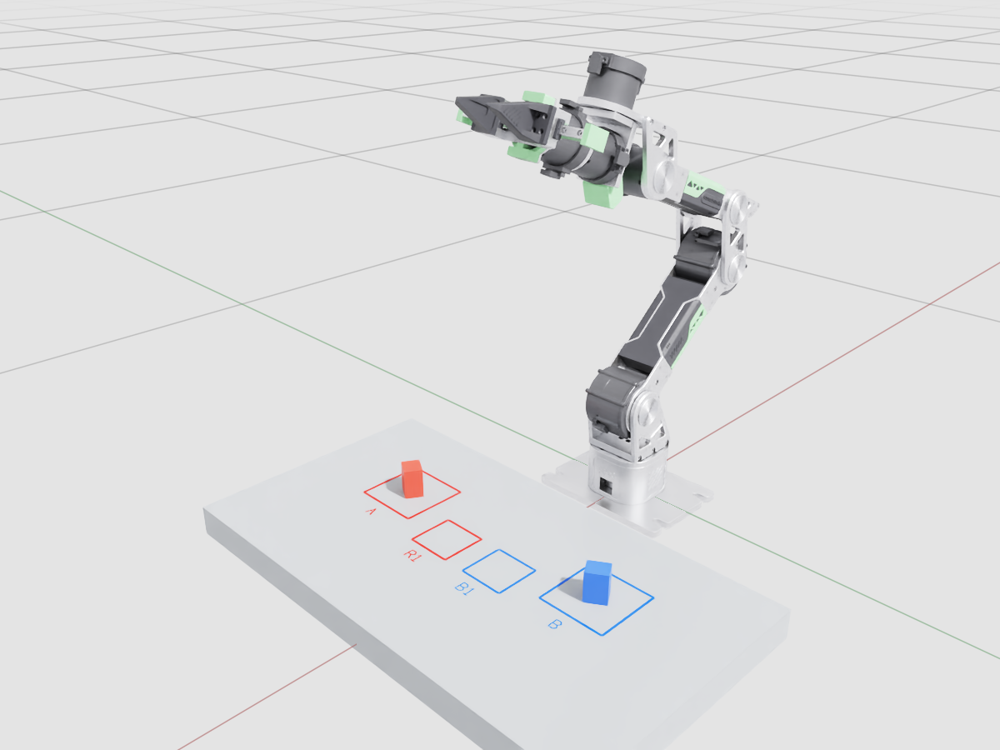

# Protected Robot Controller

PRC verifies signed, bounded commands for a simulated B601 arm and gripper and
returns signed evidence of measured joint outputs. The examples also assess
object delivery using separate, unsigned simulator observations. The simulator
and workstation are trusted; this project does not attest physical sensors or
protect against workstation root. Physical deployment requires separate hardware
and safety validation.



*The `normal` example after both deliveries: red moved from R1 to A, blue from
B1 to B. Frame rendered headlessly in Isaac Sim 6.0.*


This project is available under the [MIT License](LICENSE). Third-party components
retain their own licenses. The current source has not been deployed to the Jetson;
earlier S6 experiments used different source and configuration.

Maintained by [Jabobu](https://github.com/Jabobu). For maintainer contact,
use the [issue tracker](https://github.com/Jabobu/protected-robot-controller-sim/issues);
the ROS package metadata uses a GitHub noreply address.

## Install and run with Docker

The default workflow requires Linux x86-64, an NVIDIA GPU and driver, Docker,
the NVIDIA Container Toolkit, network access for the initial downloads, and
sufficient disk space. Check [NVIDIA’s Isaac Sim 6.0 system requirements](https://docs.isaacsim.omniverse.nvidia.com/6.0.0/installation/requirements.html), including the published GPU and VRAM minimum. Review the [Isaac Sim license and container setup](https://docs.isaacsim.omniverse.nvidia.com/6.0.0/installation/install_container.html).
After accepting NVIDIA's terms:

```sh
export ACCEPT_EULA=Y
./tools/setup_docker.sh
./tools/run_scene.sh normal --no-record
```

Setup fetches and verifies the model and builds a PRC image from pinned NVIDIA
Isaac Sim 6.0 and ROS 2 inputs. The first build may download large files. The
examples run headlessly. Replace `normal` with `missed_grasp`, `obstructed`,
`incomplete` or `all`. Outputs are written under ignored
`artifacts/scene-work/`.

To exercise the ROS 2 service with temporary development keys:

```sh
./tools/run_ros2.sh example normal
```

The dedicated ROS service is `prc_interfaces/srv/Exchange` at
`/prc/controller/exchange`. [ROS and network setup](docs/ROS2_RUNBOOK.md)
describes the separate server/client mode. Development keys must not be used
as production identities.

## Existing Isaac installation

A local Isaac Sim 6.0 installation can be selected through its `python.sh`
launcher. The [runtime setup](docs/ROS2_RUNBOOK.md#existing-isaac-sim-installation)
describes a separate dependency directory and commands for both headless and
visual examples. Visual mode opens a new, restricted viewport; it does not
attach to an existing Isaac window. The visual ROS and recording modes are not
available.

[Protocol and bounds](docs/PROTOCOL_CONTRACT.md) ·
[Scene interface](docs/SCENE_INTERFACE.md) ·
[Tests](docs/TESTING.md) ·
[Model and licensing](docs/MODEL.md)
